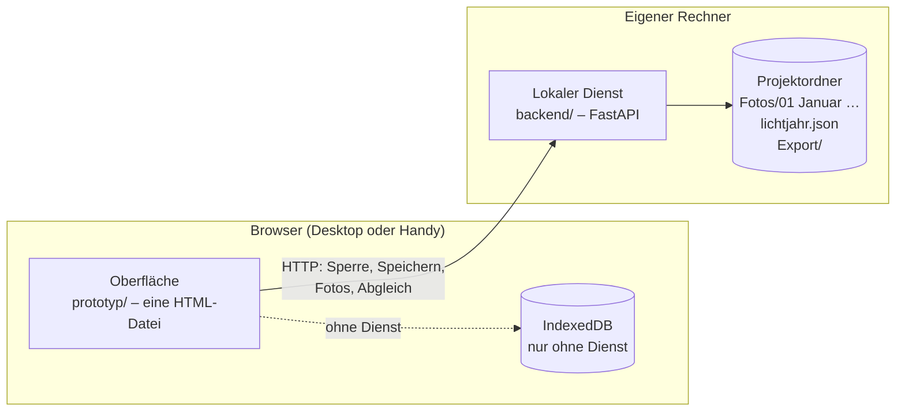

<div align="center">

# Lichtjahr

**Der Familien-Fotokalender – vom Fotoordner bis zum Druck-PDF.**

Fotos den Monaten zuordnen, Seiten gestalten, Kalendarium platzieren, an der Wand durchblättern
und ein CMYK-PDF für die Druckerei erzeugen. Im Browser, am Desktop wie auf dem Handy.

[](https://github.com/jo-tud/Lichtjahr/actions/workflows/ci.yml)
[](LICENSE)


[**▶ Im Browser ausprobieren**](https://jo-tud.github.io/Lichtjahr/) ·
[Schnellstart](#schnellstart) ·
[Funktionen](#was-lichtjahr-kann) ·
[Roadmap](#roadmap) ·
[Mitmachen](CONTRIBUTING.md) ·
[English](#english-summary)

<br>


</div>

---

## Warum Lichtjahr?

Viele Familien gestalten einmal im Jahr einen Wandkalender mit eigenen Fotos. Mit DTP-Programmen wie
Scribus oder Inkscape ist das mühsam: Kalendarien von Hand setzen, Feiertage nachschlagen, Bilder
zuschneiden, Beschnitt und Bindung beachten, Farben für die Druckerei umrechnen. Die Online-Editoren
der Fotodienste sind bequemer, binden aber an einen Anbieter und geben die Arbeit selten wieder heraus.

Lichtjahr ist für genau diesen einen Ablauf gebaut:

1. **Fotos sammeln** – ein Ordner je Monat, gern von mehreren Leuten und über das ganze Jahr verteilt.
2. **Automatisch gestalten** – ein Klick verteilt Layouts, Fotos und Kalendarien. Danach ist alles frei änderbar.
3. **An der Wand ansehen** – den fertigen Kalender durchblättern, bevor er in Druck geht.
4. **PDF erzeugen** – mit Beschnitt, CMYK-Bildern, eingebetteter Schrift und ohne Transparenz.

Die Fotos bleiben bei dir: in einem ganz normalen Ordner auf deinem Rechner, mit einem Unterordner je
Monat. Es gibt kein Konto und keine Cloud, die man dafür braucht.

## Was Lichtjahr kann

<table>
<tr>
<td width="50%" valign="top">

### Automatisch gestalten

Layout je Monat nach Fotozahl und Seitenformat, Rahmen gefüllt mit den passenden Fotos des Monats
(Favoriten, Seitenverhältnis, genug Auflösung), Kalendarium an einer ruhigen Bildstelle.
Ein Ausgangspunkt in Sekunden statt in Stunden.

</td>
<td width="50%"></td>
</tr>
<tr>
<td valign="top">

### Rahmen frei setzen

16 Vorlagen als Start, dann Rahmen verschieben, an den Ecken skalieren, überlagern, drehen und
duplizieren – mit Einrasten an Rändern, Mitte und Nachbarrahmen. Doppelklick öffnet den
Bildausschnitt: Foto unter dem Rahmen schieben, zoomen, „Füllen“ oder „Ganz zeigen“.

</td>
<td></td>
</tr>
<tr>
<td valign="top">

### Das Kalendarium sucht sich seinen Platz

„Platz automatisch finden“ analysiert das Foto: Wo ist wenig Detail, wo ist die Helligkeit
gleichmäßig? Dort landet das Kalendarium, in passender Form (Leiste, Spalte, Raster), mit lesbarer
Schriftfarbe und bei Bedarf einer Fläche dahinter – für eine Seite oder alle Monate auf einmal.

</td>
<td></td>
</tr>
<tr>
<td valign="top">

### Fotos und Monate

Import von Dateien, ganzen Ordnern oder per Drag & Drop. Der Monat kommt aus dem Ordnernamen, dem
EXIF-Aufnahmedatum oder dem Dateinamen. Jedes Foto gehört zu genau einem Monat; Umordnen ist ein Zug.

</td>
<td></td>
</tr>
<tr>
<td valign="top">

### Prüfen und drucken

Vor dem Export prüft Lichtjahr leere Rahmen, Auflösung, Lesbarkeit des Kalendariums, Abstand zu
Schnitt und Bindung sowie fehlende Bildtexte – mit Sprung zur Seite und, wo möglich, direkter
Korrektur. Der Leuchttisch zeigt alle Monatsansichten oder die Druckbogen.

</td>
<td></td>
</tr>
<tr>
<td valign="top">

### Auch auf dem Handy

Die eigentliche Arbeit passiert am großen Bildschirm, aber Ansehen, Fotos tauschen und
Durchblättern geht auch unterwegs – mit Wischen, Antippen und Zwei-Finger-Zoom.

</td>
<td></td>
</tr>
</table>

### Alle Funktionen im Überblick

- **Projektordner:** Mit dem lokalen Dienst ist der Kalender ein Ordner mit `Fotos/01 Januar` bis `12 Dezember`. Fotos legst du dort hinein, wann und womit du willst; die App gleicht automatisch ab. Monat wechseln verschiebt die Datei, gespeichert wird von selbst, das PDF landet in `Export/`. Bearbeiten kann immer ein Fenster, weitere sehen zu.
- **Formate:** 29,7 × 29,7 cm, DIN A3 quer und hoch, A4 quer, 30 × 30 cm, 21 × 21 cm oder eigene Maße. Formatwechsel auch später; die Seiten passen sich an.
- **Blätter:** 12 Monate, Titelblatt, Register am Ende und beliebig viele zusätzliche Blätter.
- **Ein- oder beidseitig:** Rückseiten *aufgeklappt* (oben die Rückseite des vorigen Blatts, unten der Monat, ein gemeinsames Kalendarium), als zweites Motiv je Monat oder als freie Fotoseiten.
- **Kalendarium:** Leiste, Spalte oder Raster, frei verschiebbar, Fläche dahinter mit einstellbarer Deckkraft. Feiertage nach Bundesland, Schulferien als feiner Strich, Kalenderwochen, Geburtstage (auch aus `.vcf`-Kontakten).
- **Register:** Bilder je Seite (mit Bildtexten, Nummern, Miniaturen), Text je Seite oder freier Text; fließt über beliebig viele Seiten.
- **Bindung:** Ringbindung und Aufhänger-Ausschnitt als Richtwerte oder mit Maßen aus dem Datenblatt der Druckerei.
- **Bildabstand:** 0–5 mm, für alle Seiten oder pro Seite.
- **Rückgängig/Wiederholen** mit Sprung zur geänderten Seite; der Verlauf übersteht ein Neuladen.
- **An der Wand:** Der Kalender hängt an einer Wand und wird über die Ringbindung umgeblättert – mit Klick, Wischen oder Pfeiltasten.

## Schnellstart

### Nur ausprobieren

Öffne die **[Online-Version](https://jo-tud.github.io/Lichtjahr/)**. Sie startet mit Beispielbildern.
Eigene Fotos bleiben im Browser (IndexedDB) und werden nirgendwohin hochgeladen.

Ohne Internet geht es genauso: Repository klonen und `prototyp/dist/index.html` im Browser öffnen.

### Mit Projektordner (empfohlen)

Für den echten Kalender läuft auf deinem Rechner ein kleiner Dienst, der die App ausliefert und direkt in
einem Ordner arbeitet. Voraussetzung ist Python 3.11 oder neuer.

```sh
git clone https://github.com/jo-tud/Lichtjahr.git
cd Lichtjahr/backend
python3 -m venv .venv && . .venv/bin/activate
pip install -e .

lichtjahr serve                                      # → http://localhost:8470/
```

Beim ersten Öffnen legst du den Projektordner an, zum Beispiel `~/Bilder/Kalender-2027`. Danach Fotos in
die Monatsordner legen, auch nach und nach, von mehreren Leuten und mit anderen Programmen; beim Öffnen
der App sind sie da.


Vom Handy im Heimnetz geht es mit `lichtjahr serve --host 0.0.0.0`; der Dienst zeigt dann eine Adresse mit
Zugriffsschlüssel. Mehr dazu in [`backend/README.md`](backend/README.md).

## Projektordner

```text
Kalender-2027/
├── lichtjahr.json        Manifest: Fotos, Gestaltungsstand, Revision
├── Fotos/
│   ├── 01 Januar/        ein Ordner je Monat – das ist die eigentliche Zuordnung
│   ├── …
│   ├── 12 Dezember/
│   └── Ohne Monat/
├── Export/               fertige PDFs
└── .lichtjahr/           Sperre, Journal, interne Daten
```

Der Ordner ist das Projekt: Er lässt sich kopieren, sichern und mit Nextcloud, Syncthing oder einem
Netzlaufwerk teilen. Fotos werden über ihren SHA-256-Hash wiedererkannt, auch wenn sie umbenannt oder
verschoben wurden.

## Stand des PDF-Exports

Ehrlich gesagt: Das PDF ist ein **guter Entwurf, aber noch nicht als druckfertig geprüft.**

| Bereits umgesetzt | Noch offen |
|---|---|
| Beschnitt, TrimBox und BleedBox | ICC-Farbmanagement (z. B. FOGRA39/51) |
| Bilder als CMYK-JPEG (DeviceCMYK) | PDF/X-Ausgabe |
| Schrift eingebettet (Jost) | Druckereiprofile mit deren Vorgaben |
| Keine Transparenz – Flächen werden eingerechnet | Preflight gegen diese Profile |
| Auflösungsprüfung je Rahmen | |

Die CMYK-Umrechnung ist eine einfache Formel ohne ICC-Profil. Für den Druck lohnt ein Proof oder die
Farbumrechnung durch die Druckerei. Echtes Farbmanagement kommt mit dem Export im lokalen Dienst.

## Aufbau



Die Oberfläche erkennt beim Start, ob sie vom Dienst ausgeliefert wird. Ohne Dienst (Datei, GitHub Pages)
arbeitet sie wie bisher nur im Browser.

| Ordner | Inhalt |
|---|---|
| [`prototyp/`](prototyp) | Die Oberfläche: Vanilla JavaScript ohne Framework und ohne Build-Abhängigkeiten. Seiten werden in Millimetern beschrieben und daraus als SVG (Editor) und als PDF (Export) gezeichnet. Eigener CMYK-JPEG-Encoder und PDF-Writer. |
| [`backend/`](backend) | Der lokale Dienst: Python, FastAPI, Pillow. Speicher-Adapter mit atomaren Operationen, Projektsperre mit Lease, Manifest mit Revision und ETag, Journal für Dateiverschiebungen. |
| [`docs/`](docs) | UX-Prüfung und die Bilder für dieses README. |
| [`tools/`](tools) | `screenshots.cjs` erzeugt die Bilder in `docs/images/`, `e2e-dienst.cjs` testet Oberfläche und Dienst zusammen im Browser. |

<details>
<summary>Dateien des Prototyps</summary>

| Datei | Inhalt |
|---|---|
| `src/style.css`, `src/body.html` | Oberfläche |
| `src/a1_core.js` | Formate, Farben, Feiertage, Vorlagen, Zustand, Rückgängig, Speichern |
| `src/a2_photos.js` | Import, EXIF, Monatserkennung, Beispielbilder |
| `src/a3_render.js` | Geometrie in mm, Kalendarium, Register, SVG-Darstellung, Bindung |
| `src/a4_ui.js` | Ansichten Projekt, Fotos, Gestalten, Druck |
| `src/a5_actions.js` | Aktionen und automatisches Verteilen |
| `src/a6_editor.js` | Ziehen, Zoomen, Verschieben im Editor |
| `src/a7_export.js` | PDF-Export und Start |
| `src/a8_wall.js` | Ansicht „An der Wand“ |
| `src/a9_place.js` | Bildanalyse für „Platz automatisch finden“ |
| `src/b1_service.js` | Anbindung an den lokalen Dienst: Projektwahl, Sperre, Speichern, Abgleich, Hochladen |
| `src/jpeg.js`, `src/pdf.js` | CMYK-JPEG-Encoder und minimaler PDF-Writer |
| `src/schoolholidays.js` | Schulferien 2025–2028 je Bundesland |
| `fonts/fonts.js` | Jost (Regular, SemiBold), auf Windows-1252 reduziert; erzeugt mit `tools/mkfont.py` |

</details>

### Selbst bauen und testen

```sh
prototyp/build.sh                         # → prototyp/dist/index.html
cd backend && pip install -e '.[dev]' && pytest
```

## Roadmap

- [x] Klickbarer Prototyp mit Gestaltung, Register, Wandansicht und PDF-Entwurf
- [x] Lokaler Dienst mit Projektordner, Sperre und Journal
- [x] UX-Prüfung durch unabhängige Agenten ([Ergebnis](docs/UX-PRUEFUNG.md))
- [x] Oberfläche an den lokalen Dienst angebunden (Projektwahl, Abgleich, Monatsordner als Quelle, Export in den Ordner)
- [ ] Nextcloud/WebDAV als zweiter Speicher-Adapter
- [ ] Export im Dienst: ICC-Farbmanagement (LittleCMS), PDF/X, Druckereiprofile, Preflight
- [ ] Gesichter beim automatischen Zuschnitt berücksichtigen

Ideen und Wünsche gern als [Issue](https://github.com/jo-tud/Lichtjahr/issues).

## Mitmachen

Beiträge sind willkommen – vom Fehlerbericht über neue Layout-Vorlagen bis zum Code. Wie das Projekt
gebaut, getestet und geprüft wird, steht in [CONTRIBUTING.md](CONTRIBUTING.md).

## Lizenz und Quellen

- **Code:** [MIT-Lizenz](LICENSE)
- **Schrift:** [Jost](https://github.com/indestructible-type/Jost) von indestructible type\*, SIL Open Font License 1.1 ([`prototyp/fonts/OFL.txt`](prototyp/fonts/OFL.txt))
- **Schulferien:** Contains information from [OpenHolidays API](https://www.openholidaysapi.org), which is made available here under the [Open Database License (ODbL) 1.0](https://opendatacommons.org/licenses/odbl/1-0/). Der Auszug in `prototyp/src/schoolholidays.js` steht ebenfalls unter der ODbL. Alle Angaben ohne Gewähr.
- **Beispielbilder:** werden beim Start im Browser gezeichnet; es sind keine echten Fotos enthalten.

---

## English summary

**Lichtjahr** is a web app for the yearly family photo wall calendar: assign photos to months, lay out
pages with free frames, let the calendar grid find a calm spot in each photo, flip through the result
on a virtual wall and export a CMYK PDF with bleed for the print shop.

- **Try it:** [jo-tud.github.io/Lichtjahr](https://jo-tud.github.io/Lichtjahr/) – runs entirely in the browser, your photos never leave it. Or open `prototyp/dist/index.html` locally.
- **Local service (recommended):** `backend/` is a small FastAPI service that serves the app and works directly in a project folder with one subfolder per month: drop photos into the folders, the app picks them up; edits are saved to `lichtjahr.json`, PDFs go to `Export/` (`pip install -e backend && lichtjahr serve`).
- **Status:** working prototype, German UI. The PDF is a solid draft (CMYK images, bleed, embedded font, no transparency) but not yet colour-managed (no ICC profile, no PDF/X).
- **Licence:** MIT for the code; Jost font under OFL 1.1; school holiday data from OpenHolidays API under ODbL 1.0.
