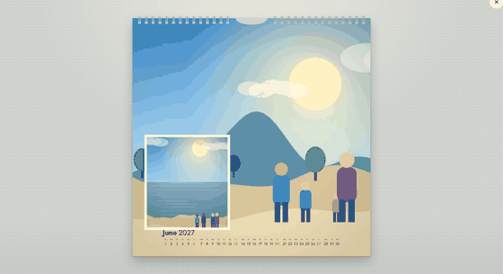
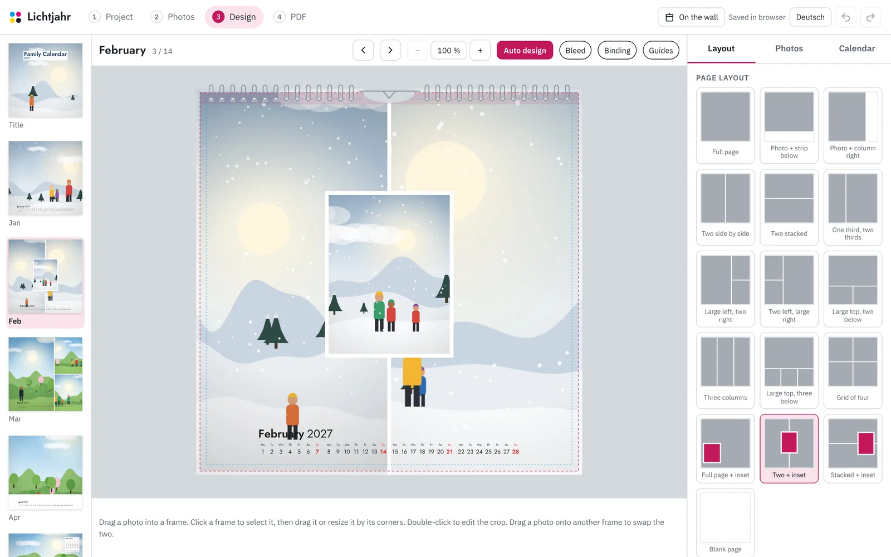
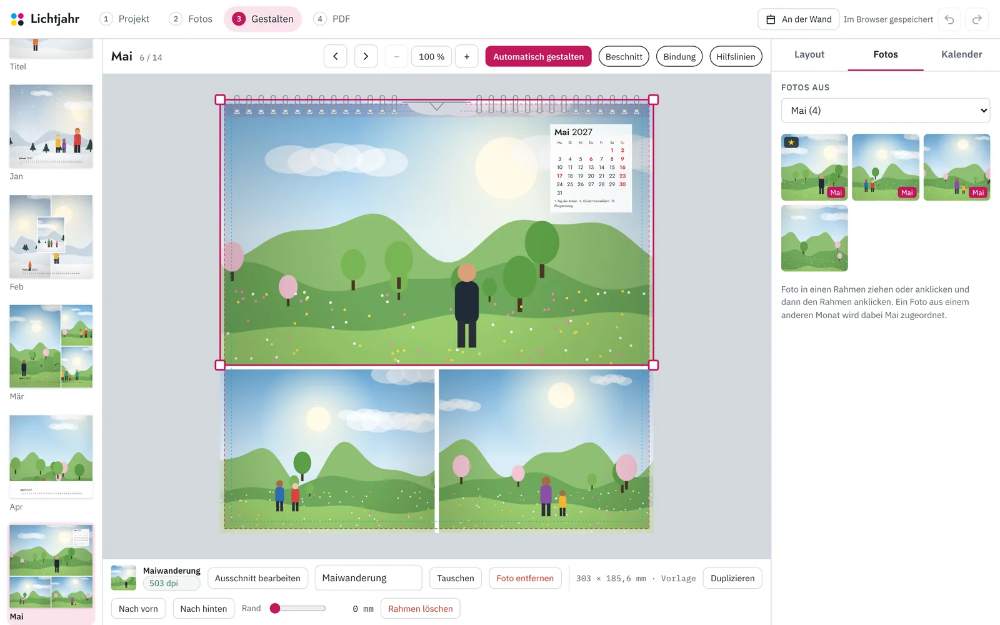
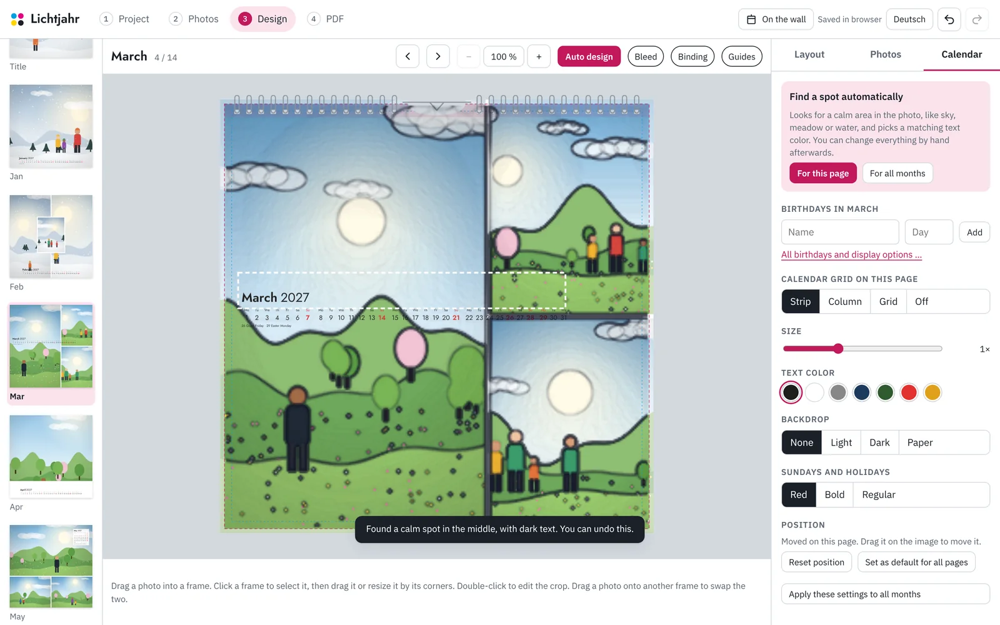
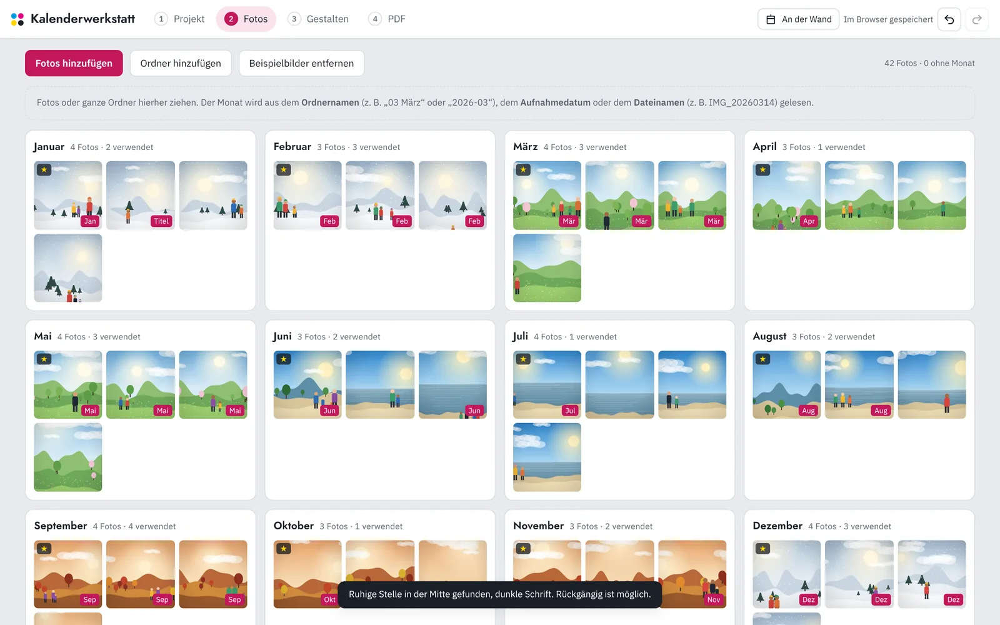
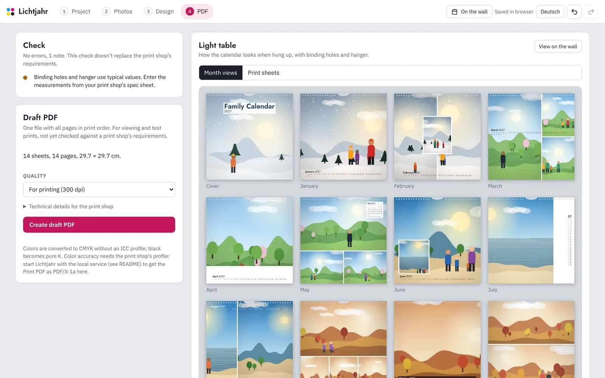
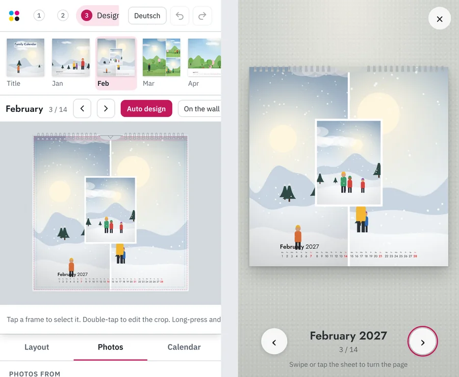
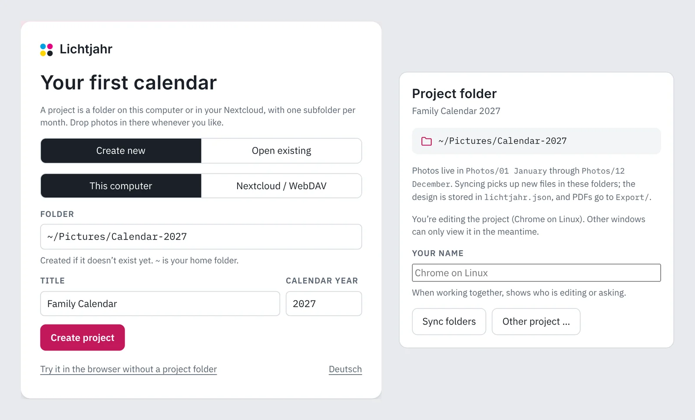
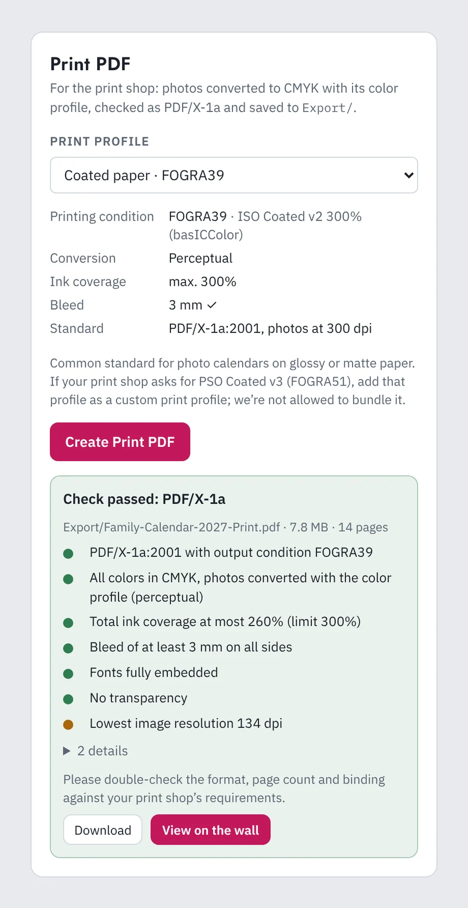
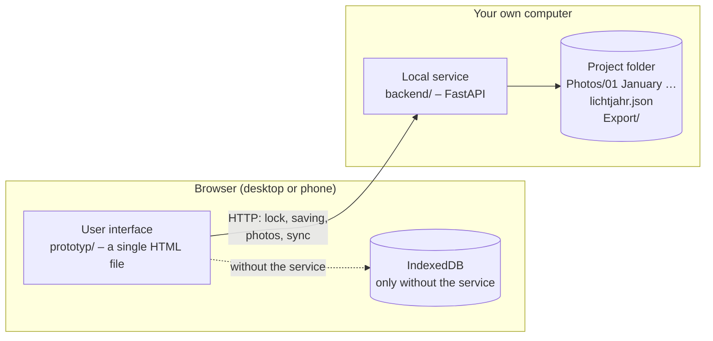

<div align="center">

# Lichtjahr

**English** · [Deutsch](README.de.md)

**The family photo calendar – from photo folder to Print PDF.**

Assign photos to months, design the pages, place the calendar grid, flip through the result on a wall
and create a CMYK PDF for the print shop. In the browser, on desktop and phone alike.

[](https://github.com/jo-tud/Lichtjahr/actions/workflows/ci.yml)
[](LICENSE)
[](https://github.com/jo-tud/Lichtjahr/releases/latest)


[**▶ Try it in your browser**](https://jo-tud.github.io/Lichtjahr/app/) ·
[Website](https://jo-tud.github.io/Lichtjahr/) ·
[**⬇ Download**](https://github.com/jo-tud/Lichtjahr/releases/latest) ·
[Quick start](#quick-start) ·
[Features](#what-lichtjahr-can-do) ·
[Roadmap](#roadmap) ·
[Contributing](CONTRIBUTING.md)

<br>



</div>

---

## Why Lichtjahr?

Many families make a wall calendar with their own photos once a year. If you have done it before, you know
the work behind it: gathering photos from several people and sorting them into months, setting up calendar
grids, looking up holidays and birthdays, choosing crops, keeping bleed and binding in mind, and in the end
delivering a file the print shop will accept. And because it only comes around once a year, you start almost
from scratch every time.

Lichtjahr is built for exactly this one workflow:

1. **Collect photos** – one folder per month, contributed by several people and spread across the whole year.
2. **Design automatically** – one click distributes layouts, photos and calendar grids. After that, everything can be changed freely.
3. **See it on the wall** – flip through the finished calendar before it goes to print.
4. **Create the PDF** – with bleed, CMYK images, an embedded font and no transparency.

Your photos stay with you: in an ordinary folder on your computer, with one subfolder per month. No account
and no cloud required.

## What Lichtjahr can do

<table>
<tr>
<td width="50%" valign="top">

### Automatic design

A layout for each month based on the number of photos and the page format, frames filled with the month's
best-suited photos (favorites, aspect ratio, enough resolution), and the calendar grid placed on a calm area
of the picture. A starting point in seconds instead of hours.

</td>
<td width="50%"></td>
</tr>
<tr>
<td valign="top">

### Place frames freely

16 templates to start with, then move frames, scale them by their corners, overlap, rotate and duplicate
them – snapping to edges, the center and neighboring frames. Double-click to adjust the crop: slide the
photo under the frame, zoom, "Fill" or "Show whole".

</td>
<td></td>
</tr>
<tr>
<td valign="top">

### The calendar grid finds its own spot

"Find a spot automatically" analyzes the photo: where is there little detail, where is the brightness even?
That is where the calendar grid goes, in a fitting shape (strip, column, grid), with a legible text color
and a backdrop if needed – for one page or all months at once. With the local service it also knows where the
**faces** are: the calendar grid never covers a head, automatic crops keep everyone in the picture, and the
check list points out faces cut off at the edge.

</td>
<td></td>
</tr>
<tr>
<td valign="top">

### Photos and months

Import single files, whole folders or by drag and drop. The month comes from the folder name, the EXIF
capture date or the file name. Every photo belongs to exactly one month; moving it to another is a single step.

</td>
<td></td>
</tr>
<tr>
<td valign="top">

### Check and print

Before exporting, Lichtjahr checks for empty frames, resolution, legibility of the calendar grid, distance
to the trim and binding, and missing captions – with a jump to the page and, where possible, a direct fix.
The light table shows all month pages or the print sheets.

</td>
<td></td>
</tr>
<tr>
<td valign="top">

### On your phone, too

The real work happens on a big screen, but viewing, swapping photos and flipping through also work on
the go – with swiping, tapping and pinch-to-zoom.

</td>
<td></td>
</tr>
</table>

### All features at a glance

- **Project folder:** With the local service, the calendar is a folder containing `Photos/01 January` through `12 December`. Put photos in there whenever and with whatever you like; the app syncs automatically. Changing a photo's month moves the file, saving happens on its own, and the PDF ends up in `Export/`. One window can edit at a time; others can watch. The folder can be on your computer or directly in your [Nextcloud](#in-your-nextcloud).
- **Formats:** 29.7 × 29.7 cm, A3 landscape and portrait, A4 landscape, 30 × 30 cm, 21 × 21 cm or a custom size. You can change the format later; the pages adapt.
- **Sheets:** 12 months, a cover, a photo index at the end and as many extra sheets as you like.
- **Single- or double-sided:** Back sides *unfolded* (the back of the previous sheet on top, the month below, one shared calendar grid), as a second picture per month or as free photo pages.
- **Calendar grid:** Strip, column or grid, freely movable, with a backdrop of adjustable opacity. Four designs (Classic, Modern, Calm, Bold), shown as previews of the actual month, plus details: month name, weekday labels, week separation, day number weight and, for the strip, full page width. Whatever you pick, the layout follows fixed rules: equal-width figures, never-crowded cells, clear week breaks, no text below 6 pt, and it always fits on the page. Public holidays by German state, school holidays as a fine line, week numbers, birthdays (also from `.vcf` contacts).
- **Languages:** The app is available in English and German. It follows your browser's language and can be switched at any time. The printed calendar has its own language setting for month names, weekdays, holidays and the photo index – so you can work in one language and print in the other. So far, only German public holidays and school holidays (for each of Germany's states) are supported.
- **Photo index:** Pictures per page (with captions, numbers, thumbnails), text per page or free text; flows over as many pages as needed.
- **Print PDF:** PDF/X-1a or PDF/X-4 with the print shop's color profile, a check report and storage in `Export/` (with the local service, see [below](#print-pdf-and-color-management)).
- **Binding:** Wire binding and hanger cut-out as guideline values or with measurements from the print shop's data sheet.
- **Photo spacing:** 0–5 mm, for all pages or per page.
- **Enhance photo:** *Auto* corrects exposure, tonal range, white balance, contrast and color with one click, with an adjustable strength; *All photos automatically* does it for the whole calendar. It works in linear light: exposure in stops with a soft shoulder, and only where a photo falls outside the range of well-exposed pictures. Snow stays bright and candlelight dark. White balance is a majority of four published estimators (Cheng et al. PCA, Shades of Gray, Gray-Edge, brightest pixels), applied only as far as they agree. Faces never set a target brightness or skin tone: they are left out of all statistics and only act as limits (no clipped faces; facial shadows stay printable). Auto is therefore the same for every skin tone, which a test checks with light and dark skin in the same scene. Sunsets keep their warmth. Looks (Vivid, Warm, Soft, Film, Black & white, B&W strong) appear as tiles of your own photo, each with its own strength. On top, brightness, contrast, warmth and color, and on request highlights, shadows and tint, right below the picture; press and hold *Original* to compare.
- **Backlight and noise:** With the local service, Lichtjahr measures every photo in the calendar. A face against a bright sky gets lifted by exposure fusion: the service builds five exposures from the one photo and blends their well-exposed parts, while a white sky stays white. Dark phone photos get their color noise reduced firmly and their luminance noise gently. The check list names such photos with a one-click fix, *Auto* includes it, and two sliders fine-tune it. Preview, soft proof, Draft PDF and Print PDF all show the same result.
- **Highlights, shadows and clarity, done locally:** With the local service these sliders work like in professional raw developers: edge-aware instead of a global curve. Shadows and highlights follow the lighting (an edge-aware base layer), so shadowed areas open up while surfaces keep their brightness. Dark skin, hair and clothing are not washed out, and a white sky stays white. Clarity strengthens or softens mid-sized detail with a local Laplacian filter, without halos. A face is never lifted more than its surroundings, so the decision depends on the light, not on skin tone; a test checks this with light and dark skin.
- **Who appears how often:** With the local service Lichtjahr recognizes faces across photos and shows who is in how many photos and how often in the calendar, with whoever is still missing listed first; give names, show all photos of a person, and the check list reminds you of anyone named who isn't in the calendar yet. Everything runs on your computer; the recognition model (10 MB) is downloaded once when you first use it, and face features stay in the service's local cache – the project only stores names.
- **Burst series:** Five nearly identical shots of the same moment? Lichtjahr finds such series (same month and day, very similar picture) and suggests the best one: the sharpest, well exposed, faces clearly visible, favorites count. The rest can be set aside with one click; if one of them is already in the calendar, the chosen photo takes its place.
- **Match all months:** Exposure and color mood of the twelve months are brought closer together, as much as you like, shown side by side with a press-and-hold before view. The seasons stay recognizable. The check list points out months that are noticeably darker or brighter than the rest. The originals stay untouched; the same recipe drives the preview, the soft proof and the PDF.
- **Undo/redo** with a jump to the changed page; the history survives a reload.
- **On the wall:** The calendar hangs on a wall and its pages turn over the wire binding – by click, swipe or arrow keys.

## Quick start

### Just try it

Open the **[online version](https://jo-tud.github.io/Lichtjahr/app/)**. It starts with sample pictures.
Your own photos stay in the browser (IndexedDB) and are never uploaded anywhere.

It works just the same without internet: clone the repository and open `prototyp/dist/index.html` in your browser.

### On your computer (recommended)

For the real calendar, a small service runs on your computer. It serves the app and works directly in a
folder.

1. Download **`Lichtjahr-<version>.zip`** from the [latest release](https://github.com/jo-tud/Lichtjahr/releases/latest) and unpack it.
2. Double-click **`Lichtjahr.command`** (macOS), **`Lichtjahr.bat`** (Windows) or run `./lichtjahr.sh` (Linux).
3. Lichtjahr opens in your browser. Keep the window open while you work; close it to quit.

The first start sets up the helper program [uv](https://docs.astral.sh/uv/) (it asks first), Python and all
packages in your user folder, about 150 MB; nothing is installed system-wide. Later starts take a few seconds.
If macOS refuses to open the script: System Settings → Privacy & Security → “Open Anyway”. On Windows,
SmartScreen may ask: “More info” → “Run anyway”.

<details>
<summary>With a terminal</summary>

If you already have uv, one command is enough (the version number is in the release):

```sh
uvx --python 3.12 --with pillow-heif --from https://github.com/jo-tud/Lichtjahr/releases/download/v1.0.0/lichtjahr-1.0.0-py3-none-any.whl lichtjahr
```

From the repository, with Python 3.11 or newer:

```sh
git clone https://github.com/jo-tud/Lichtjahr.git
cd Lichtjahr/backend
python3 -m venv .venv && . .venv/bin/activate
pip install -e .

lichtjahr serve                                      # → http://localhost:8470/, opens the browser
```

</details>

The first time you open it, you create the project folder, for example `~/Pictures/Calendar-2027`. Then put
photos into the month folders – bit by bit, from several people and with other programs; they will be there
when you open the app.



To use it from your phone on your home network, start it with `--host 0.0.0.0` (for example
`./lichtjahr.sh --host 0.0.0.0`); the window then shows an address with an access key. More in [`backend/README.md`](backend/README.md).

## Project folder

```text
Calendar-2027/
├── lichtjahr.json        Manifest: photos, design state, revision
├── Photos/
│   ├── 01 January/       one folder per month – this is the actual assignment
│   ├── …
│   ├── 12 December/
│   └── No month/
├── Export/               finished PDFs
└── .lichtjahr/           lock, journal, internal data
```

The folder is the project: you can copy it, back it up and share it via Syncthing or a network drive.
Photos are recognized by their SHA-256 hash, even after they have been renamed or moved.

### In your Nextcloud

The project folder can also live directly in **Nextcloud** (or on another WebDAV server). In the project
picker, choose *Nextcloud / WebDAV* and enter the folder's WebDAV address, your user name and an
**app password** (Nextcloud → Settings → Security; revocable at any time). Everyone in the family can then
drop photos into the month folders from the Nextcloud app on their phone, and the calendar picks them up.

- The editing lock works across devices because Nextcloud checks it on the server (conditional requests with ETags).
- The app password stays on the computer running the service (`credentials.json`, readable only by you), never in
  the project, the project list or the browser.
- A folder synced by the Nextcloud desktop client works too, but then the lock is only as reliable as the sync;
  the direct WebDAV connection is the safer choice when several people edit.

## Print PDF and color management

With the local service, Lichtjahr creates a **Print PDF conforming to PDF/X-1a:2001 or PDF/X-4**:

1. The app lays out the pages; text, calendar grid and backdrops are CMYK vectors, and the photos go to the service as sRGB.
   Photos with a **wider color space** (Display P3 from an iPhone, Adobe RGB from a camera) are rendered by the service
   straight from the original instead, so their vivid colors are not clipped to sRGB first.
2. The service converts the photos to CMYK with **LittleCMS** using the print shop's ICC profile (perceptual, or relative colorimetric with black point compensation).
3. It writes PDF/X-1a (PDF 1.3, the most widely accepted) or PDF/X-4 (PDF 1.6 with XMP metadata, also takes ICC version 4 profiles) with an output condition (OutputIntent including the embedded profile), bleed box and trim box.
4. A **preflight** checks the finished file and shows the report in the app; the PDF ends up in `Export/`.



| The preflight checks | |
|---|---|
| PDF/X identifier (for PDF/X-4 also in the XMP metadata), PDF version, output condition, document ID, title, trapping | Required entries of the chosen standard |
| CMYK only, no RGB images or colors | Photos converted with the profile |
| Total ink coverage | Against the print profile's limit, e.g. 300 % |
| Bleed on all sides | Against the print profile's requirement |
| Fonts embedded, no transparency | Transparency is only a note for PDF/X-4 |
| Resolution of every photo | A note when it will look visibly blurry |

**Print profiles:** Included are *Coated paper · FOGRA39* (ISO Coated v2 300 %) and *Uncoated paper · FOGRA47*,
both by basICColor under the zlib license. You add your print shop's profile, such as **PSO Coated v3 (FOGRA51)** from the
[European Color Initiative](https://eci.org/doku.php_id=en_downloads.html), as an `.icc` file; Lichtjahr
recognizes the printing condition and takes ink coverage, bleed and conversion from your settings. We may not
redistribute the ECI and Adobe profiles, but embedding them in the PDF is allowed.

**Honest limits:**
- Checking is done by Lichtjahr's own preflight, not by a certified tool such as Acrobat Preflight.
- Format, page count, binding and paper are set by the print shop; Lichtjahr does not verify them against its requirements.
- iPhone photos in HEIC work with the local service and its optional `heic` extension; RAW files need converting first. Photos without a color profile count as sRGB.
- The soft proof is only as accurate as your screen. On an uncalibrated laptop it shows the direction (duller, darker, paper tint), not the exact shade.

**Adapted for print:** Paper doesn't glow like a screen and has less contrast. With *Adapt photos to paper and print* (on by default) the service lifts the midtones slightly, opens up the shadows and sharpens the photos for print. How much depends on the print profile: more on uncoated paper with its lighter black than on coated paper. Background and panels stay untouched, and the print preview shows the result. Switch off any automatic image correction at the print shop so nothing gets corrected twice.

**Print preview on screen (soft proof):** Under *Check on screen*, the editor and the wall view show the photos as they
will come out of the press: converted with the print profile and back to the screen, optionally including the paper
white. Bright blues, neon colors and deep shadows lose punch exactly where they will in print. A gray hatching marks
areas that the printing process clearly cannot reproduce, so you can still swap a photo or tone it down.

<br clear="right">

**Without the service** (online version, file opened in the browser) you get the **Draft PDF**: CMYK with
a simple conversion without an ICC profile, with bleed, an embedded font and no transparency. It is good for
viewing and test prints; the Print PDF is the one meant for the print shop.

## Architecture



At startup, the app detects whether it is being served by the service. Without the service (local file,
GitHub Pages), it works in the browser only, as before.

| Folder | Contents |
|---|---|
| [`prototyp/`](prototyp) | The user interface: vanilla JavaScript with no framework and no build dependencies. Pages are described in millimeters and drawn from that as SVG (editor) and as PDF (export). Its own CMYK JPEG encoder and PDF writer. |
| [`backend/`](backend) | The local service: Python, FastAPI, Pillow. Storage adapter with atomic operations, project lock with lease, manifest with revision and ETag, journal for file moves. |
| [`docs/`](docs) | UX review and the images for this README. |
| [`tools/`](tools) | `screenshots.cjs` and `screenshots-dienst.cjs` create the images in `docs/images/` (English) and `docs/images/de/` (German), `e2e-dienst.cjs` tests the app and the service together in the browser, `i18n-check.cjs` finds missing English translations in the browser, `i18n-keys.cjs` checks them in CI. |

<details>
<summary>Prototype files</summary>

| File | Contents |
|---|---|
| `src/style.css`, `src/body.html` | User interface |
| `src/i18n.js`, `src/i18n/en_*.js` | Language switching and the English dictionaries |
| `src/a1_core.js` | Formats, colors, holidays, templates, state, undo, saving |
| `src/a2_photos.js` | Import, EXIF, month detection, sample pictures |
| `src/a3_render.js` | Geometry in mm, calendar grid, photo index, SVG rendering, binding |
| `src/a4_ui.js` | Project, Photos, Design and Print views |
| `src/a5_actions.js` | Actions and automatic distribution |
| `src/a6_editor.js` | Dragging, zooming and moving in the editor |
| `src/a7_export.js` | PDF export and startup |
| `src/a8_wall.js` | "On the wall" view |
| `src/a9_place.js` | Image analysis for "Find a spot automatically" |
| `src/b1_service.js` | Connection to the local service: project selection, lock, saving, sync, upload |
| `src/b2_print.js` | Print PDF via the local service: print profile, export, check report |
| `src/b3_faces.js` | Faces from the service: crop around faces, keep the calendar grid off heads, warnings |
| `src/b6_people.js` | Who appears how often: group faces into people, names, filter, check |
| `src/b5_series.js` | Burst series: similar photos (dHash, color, aspect), best one by sharpness, exposure, faces |
| `src/b4_adjust.js` | Enhance photos: recipes compiled to color matrix and tone curve, SVG filter, pixels |
| `src/jpeg.js`, `src/pdf.js` | CMYK JPEG encoder and minimal PDF writer |
| `src/schoolholidays.js` | School holidays 2025–2028 for each German state |
| `fonts/fonts.js` | Jost (Regular, SemiBold), reduced to Windows-1252; created with `tools/mkfont.py` |

</details>

### Build and test it yourself

```sh
prototyp/build.sh                         # → prototyp/dist/index.html
cd backend && pip install -e '.[dev]' && pytest
```

## Roadmap

- [x] Clickable prototype with design, photo index, wall view and Draft PDF
- [x] Local service with project folder, lock and journal
- [x] UX review by independent agents ([results](docs/UX-PRUEFUNG.md), in German)
- [x] App connected to the local service (project selection, sync, month folders as the source, export into the folder)
- [x] Nextcloud/WebDAV as a second storage location (lock checked on the server, app password stored locally)
- [x] Print PDF in the service: ICC color management (LittleCMS), PDF/X-1a, print profiles, preflight
- [x] English user interface, with a separate language setting for the printed calendar
- [x] On-screen soft proof with gamut warning, PDF/X-4
- [x] Wide color (Display P3, Adobe RGB) printed straight from the original
- [x] Faces: automatic crops keep them in the picture, the calendar grid avoids them, cut-off faces are flagged
- [x] Optimize photos for print: automatic mode, looks, manual sliders, matching months, print adaptation
- [x] Backlight (exposure fusion) and noise reduction, suggested by the check list
- [x] Who appears how often in the photos (local face recognition)
- [x] Burst series: best photo suggested
- [x] Version 1.0: download with start scripts for macOS, Windows and Linux ([changelog](CHANGELOG.md))
- [x] [Website](https://jo-tud.github.io/Lichtjahr/) in English and German, without third-party resources

Ideas and wishes are welcome as an [issue](https://github.com/jo-tud/Lichtjahr/issues).

## Contributing

Contributions are welcome – from bug reports to new layout templates to code. How the project is built,
tested and reviewed is described in [CONTRIBUTING.md](CONTRIBUTING.md).

## License and credits

- **Code:** [MIT License](LICENSE)
- **Font:** [Jost](https://github.com/indestructible-type/Jost) by indestructible type\*, SIL Open Font License 1.1 ([`prototyp/fonts/OFL.txt`](prototyp/fonts/OFL.txt))
- **School holidays:** Contains information from [OpenHolidays API](https://www.openholidaysapi.org), which is made available here under the [Open Database License (ODbL) 1.0](https://opendatacommons.org/licenses/odbl/1-0/). The extract in `prototyp/src/schoolholidays.js` is also licensed under the ODbL. No guarantee of accuracy.
- **Face recognition:** [SFace](https://github.com/opencv/opencv_zoo/tree/main/models/face_recognition_sface) (OpenCV Zoo), Apache License 2.0; not included in the repository, downloaded on first use and checked against its SHA-256.
- **Face detection:** [YuNet](https://github.com/opencv/opencv_zoo/tree/main/models/face_detection_yunet) by Shiqi Yu, MIT license ([`backend/lichtjahr/models/`](backend/lichtjahr/models)); it finds faces, it does not recognize people. Test photos in `backend/tests/data/` are NASA portraits in the public domain.
- **ICC print profiles:** `ISOcoated_v2_300_bas.icc` and `PSO_Uncoated_ISO12647_bas.icc` by basICColor GmbH, zlib/libpng license ([`backend/lichtjahr/icc/`](backend/lichtjahr/icc))
- **Service libraries:** FastAPI, Pillow with LittleCMS, pikepdf/qpdf (each under its own free license)
- **Sample pictures:** drawn in the browser at startup; no real photos are included.
